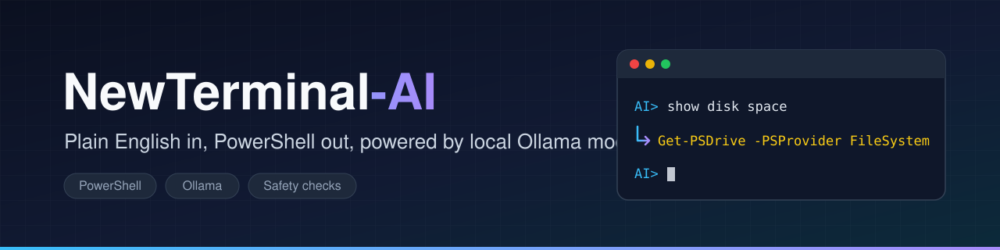
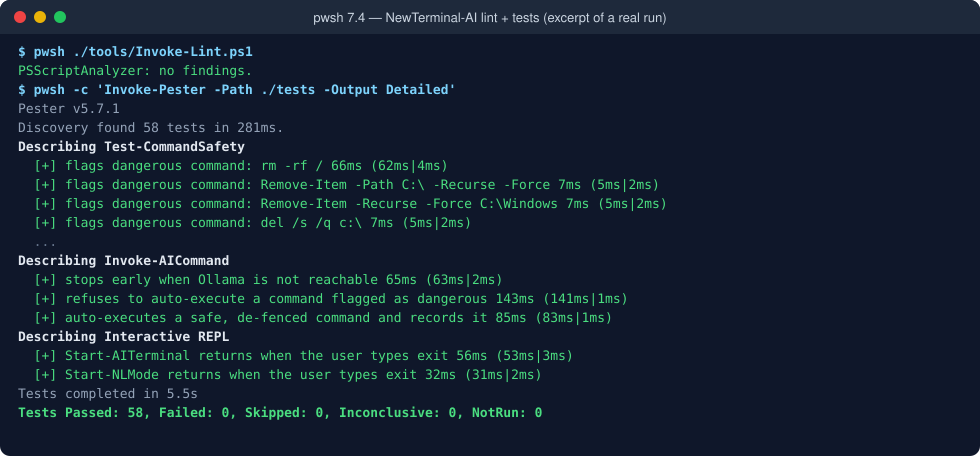
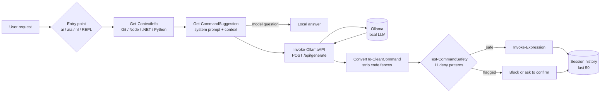

<div align="center">



**Plain English in, PowerShell out, powered by local Ollama models.**

[](LICENSE)
[](https://github.com/muhib-karim/NewTerminal-AI)
[](https://github.com/muhib-karim/NewTerminal-AI/actions/workflows/ci.yml)

</div>

---

NewTerminal-AI is a PowerShell module that turns natural-language requests ("show disk space", "find file notes.txt") into PowerShell commands. It uses a **local** LLM served by [Ollama](https://ollama.com), shows you the generated command, checks it against a denylist of destructive patterns, and then runs it, either automatically or after you confirm.

## Key features

- **Natural language → PowerShell** via Ollama's `/api/generate` endpoint (default model `llama3.2:1b`, temperature 0.1).
- **Context-aware prompts**: detects whether the current directory is a Git repository (with branch and clean/dirty status), a Node.js, .NET, or Python project, and adds that to the system prompt.
- **Safety gate**: every generated command is matched against 11 destructive patterns (`rm -rf /`, `format c:`, `Stop-Computer`, `reg delete HKLM`, recursive forced deletes on `C:\`, and others). Flagged commands are never auto-executed.
- **Three ways to run it**:
  - `ai "<request>"`: shows the command and asks `Execute? [y/N/e(dit)]`. You can also edit the command before it runs.
  - `aia "<request>"`: auto-executes safe commands with compact output.
  - An interactive REPL (`AI>` prompt) that starts automatically when the module is imported, plus `nl` for a lighter-weight variant. Built-in `help`, `history`, `clear`, `exit`.
- **Session history** of the last 50 requests, with the generated command, whether it ran, and the directory context.
- **Model questions answered locally**: "what model are you using?" is answered without an LLM call.
- **Configurable** through environment variables (see [Configuration](#configuration)).

## Demo

Lint and unit-test output from an actual local run (excerpt; omitted lines are marked `...`):

<p align="center"></p>

An example session looks like this (the generated command depends on the model):

```text
AI> show disk space
💻 Get-PSDrive -PSProvider FileSystem
...
AI> exit
👋 Goodbye!
```

## Quick start

### Prerequisites

- PowerShell 7+ (`pwsh`) on Windows, Linux, or macOS. Windows PowerShell 5.1 is targeted by the installer too.
- [Ollama](https://ollama.com) running locally (`ollama serve`) with a model pulled:

```bash
ollama pull llama3.2:1b
```

### Try it from a clone (no install)

```powershell
git clone https://github.com/muhib-karim/NewTerminal-AI.git
cd NewTerminal-AI
Import-Module ./NewTerminal-AI.psm1   # starts the AI> REPL immediately
```

To load the commands without starting the REPL:

```powershell
$env:NEWTERMINAL_AI_NO_AUTOSTART = '1'
Import-Module ./NewTerminal-AI.psm1
ai "list all files"
```

### Install

The installers copy `NewTerminal-AI.psm1` from **their own directory**, so run them from a clone:

```powershell
# Windows: installs Ollama via winget if missing, pulls llama3.2:1b,
# installs the module as "AITerminal" and adds Import-Module to your profile
.\install.ps1          # or .\install.ps1 -Force for a current-user install without prompting
```

```bash
# Linux / macOS: installs pwsh and Ollama if missing, pulls llama3.2:1b,
# installs the module and creates an `ai-terminal` launcher in /usr/local/bin (uses sudo)
./install.sh
```

After installing, open a new PowerShell session (or run `ai-terminal` on Linux/macOS) and the REPL starts.

## Usage

| Command | What it does |
|---|---|
| `ai "<request>"` | Generate a command, show context, ask `y` / `N` / `e` (edit) before running |
| `aia "<request>"` | Generate and auto-execute if it passes the safety check |
| `nl` | Lightweight REPL that uses `aia` for every line |
| `Start-AITerminal` | Main `AI>` REPL (started automatically on import); asks before running flagged commands |
| `Show-CommandHistory -Last 10` | Show recent requests and generated commands |
| `Clear-CommandHistory` | Clear session history |
| `Test-OllamaConnection` | `$true` if the Ollama API is reachable |
| `Get-ContextInfo` | Show the detected directory context |

Inside either REPL: `help`, `history`, `clear`, `exit`.

### Configuration

Set these **before** importing the module:

| Variable | Default | Purpose |
|---|---|---|
| `NEWTERMINAL_AI_MODEL` | `llama3.2:1b` | Ollama model name |
| `NEWTERMINAL_AI_OLLAMA_URL` | `http://localhost:11434` | Ollama base URL |
| `NEWTERMINAL_AI_NO_AUTOSTART` | *(unset)* | Any value skips auto-starting the REPL on import |

## Architecture

The whole runtime is one PowerShell module. A request goes through context detection, prompt construction, the Ollama call, cleanup of the reply, and the safety gate before execution.



## Testing

The test suite uses [Pester](https://pester.dev) and mocks every network call, so **Ollama is not needed** to run it. It currently has 58 tests covering the safety patterns, reply cleanup, context detection, the Ollama request shape, history limits, auto-execute vs. block behaviour, environment configuration, and that `exit` leaves both REPLs.

```powershell
Install-Module Pester -MinimumVersion 5.5 -Scope CurrentUser -Force -SkipPublisherCheck
Install-Module PSScriptAnalyzer -Scope CurrentUser -Force

./tools/Invoke-Lint.ps1          # PSScriptAnalyzer
Invoke-Pester -Path ./tests      # unit tests
```

CI ([`.github/workflows/ci.yml`](.github/workflows/ci.yml)) runs the same lint and tests on `ubuntu-latest` and `windows-latest`.

`tests/test-installation.ps1` is a separate smoke test for a real Windows install (it needs Ollama and the installed module) and is not run in CI.

## Project structure

```text
NewTerminal-AI/
├── NewTerminal-AI.psm1          # The module (all runtime logic)
├── install.ps1 / install.sh     # Installers (Windows / Linux + macOS)
├── tests/
│   ├── NewTerminal-AI.Tests.ps1 # Pester unit tests (run in CI)
│   └── test-installation.ps1    # Manual post-install smoke test (Windows)
├── tools/Invoke-Lint.ps1        # PSScriptAnalyzer wrapper
├── docs/                        # Banner, demo render, status notes
├── examples/basic-usage.md      # Example requests
├── scripts/                     # Alternate installers, a standalone Bash variant, GitHub helper
├── releases/v2.0.0/             # Snapshot of the 2.0.0 release files
└── .github/workflows/           # ci.yml (lint + tests), release.yml (zip on v* tags)
```

## Limitations and roadmap

- **The safety check is a regex denylist, not a sandbox.** Commands are run with `Invoke-Expression` under your account. Review what the model generates, especially with `aia` / `nl`.
- The system prompt is tuned for Windows PowerShell cmdlets (e.g. `Get-CimInstance Win32_OperatingSystem`), so some suggestions won't work under `pwsh` on Linux/macOS.
- History is in-memory and lost when the session ends.
- Installers must be run from a clone. The old `irm ... | iex` / `curl ... | bash` one-liners do not work because the scripts copy the module from their own directory.
- Files under `scripts/` and `releases/` are older alternates and are only lint-checked (error severity), not unit-tested.
- Ideas: persist history to disk, an OS-aware system prompt, and an allowlist mode for the safety gate.

## License

[MIT](LICENSE)
